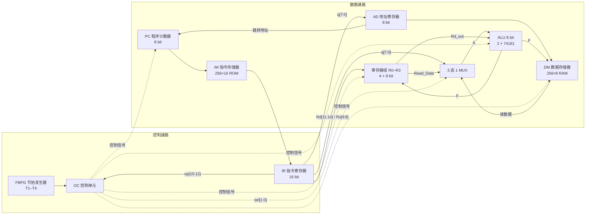

# 基于 Quartus II 的 8 位模型 CPU

> 广东海洋大学 · 硬件综合实践课程作业
>
> 使用 Quartus II 9.1 SP2 的 Block Editor（BDF 原理图）自底向上搭建的 8 位模型计算机
>
> 仓库地址：<https://github.com/lizhen-667/cpu-desiginby-quartus2-gdou>

本项目用图形化原理图的方式实现了一台简单的 8 位 CPU：8 位数据通路、16 位指令、4 个通用寄存器、256×16 的指令 ROM、256×8 的数据 RAM，以及 16 条指令。设计采用 T1–T4 四拍时序，由节拍发生器、操作控制器、ALU、寄存器组、程序计数器、地址寄存器、指令/数据存储器等模块组成。

仓库保留了课程作业的原始 Quartus 工程，包括原理图源文件、LPM 宏功能、编译报告和仿真波形。`db/`、`incremental_db/` 等目录是 Quartus 自动生成的编译中间文件，不影响阅读源码。

---

## 目录

- [1. 项目简介](#1-项目简介)
- [2. 仓库结构](#2-仓库结构)
- [3. 整机架构](#3-整机架构)
- [4. 模块与文件说明](#4-模块与文件说明)
- [5. 指令集与示例程序](#5-指令集与示例程序)
- [6. 时序模型](#6-时序模型)
- [7. 打开、编译与仿真](#7-打开编译与仿真)
- [8. 文件类型速查](#8-文件类型速查)
- [9. 已知差异与注意事项](#9-已知差异与注意事项)
- [10. 致谢](#10-致谢)

---

## 1. 项目简介

### 1.1 主要特性

| 项目 | 说明 |
| --- | --- |
| 设计方法 | Quartus II Block Editor 原理图（`.bdf`）+ LPM 宏功能 + 74181 |
| 开发工具 | Quartus II 9.1 SP2 Web Edition |
| 目标器件 | Altera Cyclone II `EP2C35F672C6` |
| 数据位宽 | 8 bit |
| 指令位宽 | 16 bit |
| 地址位宽 | 8 bit（256 字节地址空间） |
| 通用寄存器 | R0–R3，共 4 个 8 位寄存器 |
| 指令存储器 | 256 × 16 bit ROM（`IM_cpu_demo`） |
| 数据存储器 | 256 × 8 bit RAM（`DM_cpu_demp`） |
| 指令条数 | 16 条（8 条基础指令 + 8 条扩展指令） |
| 时序 | T1–T4 四拍 |
| 最终顶层 | `CPU_top/CPU_top.bdf` |

### 1.2 快速导航

- 想看整机连接：打开 `CPU_top/CPU_top.bdf`
- 想了解指令集：看 `IM(8条指令说明)/指令说明.txt` 和 `IM_cpu_demo/IM_cpu_demo.mif`
- 想研究某个部件：进入对应子目录，每个目录都是一个独立的 Quartus 工程
- 想复现实验：先阅读[第 7 节](#7-打开编译与仿真)，尤其是搜索路径的说明

---

## 2. 仓库结构

```text
cpu_final/
├── CPU_top/                  # ★ 最终整机顶层工程
│   ├── CPU_top.bdf           # 整机原理图（最终版本，顶层源文件）
│   ├── CPU_top.vhd           # Quartus 从早期原理图生成的 VHDL（仅参考）
│   ├── CPU_top.vwf           # 整机仿真波形
│   ├── lpm_ff6.*             # 16 位指令寄存器 IR
│   ├── lpm_mux8.*            # 3 选 1、8 位 ALU A 操作数选择器
│   └── ...                   # 编译报告、db、sof/pof 等生成文件
│
├── ALU_total/                # 8 位 ALU（两片 4 位 74181 级联）
│   ├── ALU_total.bdf         # ALU 顶层原理图
│   ├── alu_4_bit.bdf         # 4 位 ALU 位片（74181）
│   ├── ALU_total.vhd         # 自动生成的 VHDL
│   ├── C.bdf / D.bdf         # 仿真用的 A/B 操作数常量源
│   └── ...
│
├── Register_cpu_demo/        # 通用寄存器组 R0–R3
│   ├── Register_cpu_demo.bdf # 4 个 8 位寄存器 + 写译码 + 读选择
│   ├── lpm_ff1.*             # 8 位 DFF（每个寄存器一片）
│   ├── lpm_decode0.*         # 2-4 写地址译码器
│   ├── lpm_mux4/lpm_mux7.*   # 两个读口的选择器
│   └── ...
│
├── Pc_counter_cpu_demo/      # 程序计数器 PC
│   ├── Pc_counter_cpu_demo.bdf
│   ├── lpm_counter0.*        # 8 位可装载/可清零计数器
│   └── ...
│
├── AD_cpu_demo/              # 地址寄存器 AD
│   ├── AD_cpu_demo.bdf       # 8 位地址寄存器
│   ├── CPU_top.bdf           # 早期整机集成版本（历史参考）
│   └── ...
│
├── IM_cpu_demo/              # 指令存储器 IM 与 IR 相关文件
│   ├── IM_cpu_demo.bdf       # 256×16 ROM 顶层
│   ├── IM_cpu_demo.mif       # 指令存储器初始化文件（示例程序）
│   ├── lpm_rom0.*            # ROM 宏功能（altsyncram）
│   ├── IR_cpu_demo.*         # 早期 IR 实验工程残留文件
│   ├── IR_cpu_demo_description.txt  # 空文件
│   └── ...
│
├── DM_cpu_demp/              # 数据存储器 DM
│   ├── DM_cpu_demp.bdf       # 256×8 单端口 RAM 顶层
│   ├── DM_cpu_demp.mif       # 数据存储器初始化文件
│   ├── lpm_ram_dq3.*         # RAM 宏功能（altsyncram）
│   └── ...
│
├── OC_cpu_demo/              # 操作控制器 OC
│   ├── OC_cpu_demo.bdf       # 指令译码 + 节拍控制信号
│   ├── lpm_decode1.*         # 4-16 操作码译码器
│   └── ...
│
├── FBPG/                     # 分步脉冲发生器（节拍发生器）
│   ├── FBPG.bdf              # CLK/RST → T1–T4
│   ├── exp4_cpu.bdf          # 早期单文件整机实验（历史参考）
│   └── ...
│
└── IM(8条指令说明)/          # 指令集说明
    └── 指令说明.txt          # 16 条指令、编码示例与演示程序
```

> 每个子目录都是一个独立的 Quartus II 工程，双击其中的 `.qpf` 文件即可打开。
> 最终整机工程是 `CPU_top/CPU_top.qpf`。

---

## 3. 整机架构



### 3.1 数据流

1. **取指**：PC 输出当前指令地址，送入 IM（256×16 ROM）。
2. **指令寄存器**：IM 输出的 16 位指令锁存到 IR（`lpm_ff6`）。
3. **指令拆分**：IR 的 `[15:12]` 为操作码 `op`，`[11:10]` 为目的寄存器 `Rd`，`[9:8]` 为源寄存器 `Rs`，`[7:0]` 为立即数/地址 `q`。
4. **控制译码**：OC 根据 `op` 与节拍 T1–T4 产生 `LD_IR`、`LD_AD`、`WR_R`、`WR_M`、`set_pc`、`M`、`S[3:0]`、`CN` 等控制信号。
5. **地址形成**：AD 在 `LD_AD` 有效时锁存 `q`，作为 DM 的访问地址。
6. **操作数选择**：寄存器组有两个读口——`Read_Data`（由 `Rs` 选择）和 `Rd_out`（由 `Rd` 选择）。ALU 的 A 操作数由三选一 MUX 选择：
   - `MOVR`：选寄存器值 `Read_Data`
   - `MOVD`：选立即数 `q`
   - `MOVM`：选数据存储器读出值 `register_read`
   ALU 的 B 操作数固定为 `Rd_out`。
7. **执行与写回**：ALU 的结果 `F` 写回寄存器 `Rd`；`MOVB` 时 `F` 同时作为 DM 的写数据。
8. **下一条指令**：跳转类指令通过 `set_pc` 让 PC 装载 `AD_Out`，否则 PC 顺序递增。

> 说明：OC 输出的 `eq1`/`eq2` 在顶层被命名为 `flg[1:0]`，实际作用是选择 ALU A 操作数（`MOVD`/`MOVM` 译码），**不是** ALU 的进位/零标志。顶层还引出了 ALU 的 `F`、PC、IR、R0–R3 等内部信号，便于在波形中观察程序执行过程。

---

## 4. 模块与文件说明

### 4.1 `CPU_top/` — 最终整机顶层

整机工程把下列模块连接在一起：

`AD_cpu_demo`、`ALU_total`、`DM_cpu_demp`、`FBPG`、`IM_cpu_demo`、`OC_cpu_demo`、`Pc_counter_cpu_demo`、`Register_cpu_demo`，以及 `lpm_ff6`（IR）、`lpm_mux8`（ALU A 操作数选择）和若干逻辑门。

| 文件 | 说明 |
| --- | --- |
| `CPU_top.bdf` | ★ **最终整机原理图**，所有模块在此例化 |
| `CPU_top.vhd` | Quartus 从早期原理图生成的 VHDL，含 `sijiepai_cpu_demo` 和 2 选 1 MUX，与最终 BDF 不完全一致，仅作参考 |
| `CPU_top.vwf` | 整机仿真波形 |
| `lpm_ff6.tdf` / `.inc` / `.qip` / `.bsf` | 16 位 D 触发器，最终设计中作为 IR |
| `lpm_mux8.tdf` / `.inc` / `.qip` / `.bsf` | 3 选 1、8 位 MUX，选择 ALU A 操作数 |
| `lpm_mux1.*` / `lpm_mux5.*` | 2 选 1、8 位 MUX 宏功能包装（部分为早期版本遗留） |
| `db/`、`incremental_db/` | Quartus 编译数据库（自动生成） |
| `*.sof` / `*.pof` / `*.pin` / `*.rpt` | 编程文件、引脚报告、各阶段编译报告 |

**顶层端口**

顶层只有 `CLK` 和 `RST` 两个输入，其余均为观察/调试输出：

| 端口 | 方向 | 说明 |
| --- | --- | --- |
| `CLK` | 输入 | 系统时钟 |
| `RST` | 输入 | 复位 |
| `PC_Out[7:0]` | 输出 | PC 当前值 |
| `IR_input[15:0]` | 输出 | 指令寄存器输出 |
| `R0_reg`–`R3_reg[7:0]` | 输出 | 4 个通用寄存器观察值 |
| `F[7:0]` | 输出 | ALU 运算结果 |
| `Read_Data[7:0]` | 输出 | 寄存器组 `Rs` 读口 |
| `register_read[7:0]` | 输出 | 数据存储器读出值 |
| `q_out[7:0]` | 输出 | IR 低 8 位（立即数/地址） |
| `WR_R` / `WR_M` / `LD_IR` / `LD_AD` / `set_pc` | 输出 | 主要控制信号 |
| `T1`–`T4` | 输出 | 四拍节拍信号 |
| `Rd[1:0]` / `Rs[1:0]` | 输出 | 寄存器编号 |
| `eq1` / `flg[0]` / `flg[1]` | 输出 | 译码/操作数选择信号 |

> 因为顶层没有外部数据/指令输入端口，程序和数据分别固化在 `IM_cpu_demo.mif` 与 `DM_cpu_demp.mif` 中。仿真时只需给 `CLK`、`RST` 加激励，即可观察内部执行过程。

### 4.2 `ALU_total/` — 8 位 ALU

| 文件 | 说明 |
| --- | --- |
| `ALU_total.bdf` | ALU 顶层：两片 `alu_4_bit` 级联 + AND/NOR/NOT 标志逻辑 |
| `alu_4_bit.bdf` | 4 位 ALU 位片，内部使用 `74181` |
| `ALU_total.vhd` | 由 BDF 自动生成的 VHDL |
| `C.bdf` / `D.bdf` | 用 VCC/GND 生成常量 A/B 的辅助原理图，便于 ALU 单独仿真 |
| `lpm_and0.*` | 进位标志用的 1 位 AND 宏功能 |
| `ALU_total.vwf` / `Waveform1.vwf` | ALU 仿真波形 |

**端口**

| 端口 | 方向 | 说明 |
| --- | --- | --- |
| `A[7:0]` | 输入 | 操作数 A |
| `B[7:0]` | 输入 | 操作数 B |
| `S[3:0]` | 输入 | 74181 功能选择 |
| `M` | 输入 | `1` 为逻辑运算，`0` 为算术运算 |
| `CN` | 输入 | 进位输入 |
| `F[7:0]` | 输出 | 运算结果 |
| `C0` | 输出 | 进位标志（算术模式） |
| `C1` | 输出 | 零标志（`F == 0` 时为 `1`） |

### 4.3 `Register_cpu_demo/` — 通用寄存器组

由 4 个 8 位 DFF（`lpm_ff1`）、写地址译码器（`lpm_decode0`）和两个读口选择器（`lpm_mux4`、`lpm_mux7`）组成。

| 文件 | 说明 |
| --- | --- |
| `Register_cpu_demo.bdf` | 寄存器组顶层原理图 |
| `lpm_ff1.*` | 8 位 DFF，每个通用寄存器一片 |
| `lpm_decode0.*` | 2-4 译码器，产生 R0–R3 的写使能 |
| `lpm_mux4.*` / `lpm_mux7.*` | 两个读口的数据选择器 |
| `lpm_mux0`–`lpm_mux7.*` | 宏功能包装文件 |
| `Register_cpu_demo.vwf` | 仿真波形 |

**端口**

| 端口 | 方向 | 说明 |
| --- | --- | --- |
| `CLK` / `RST` | 输入 | 时钟、复位 |
| `WR_R` | 输入 | 写使能 |
| `Rd[1:0]` | 输入 | 目的寄存器编号（写地址、读口 2） |
| `Rs[1:0]` | 输入 | 源寄存器编号（读口 1） |
| `Write_Data[7:0]` | 输入 | 写数据 |
| `Read_Data[7:0]` | 输出 | `Rs` 选中寄存器的值 |
| `Rd_out[7:0]` | 输出 | `Rd` 选中寄存器的值 |
| `R0_reg`–`R3_reg[7:0]` | 输出 | 4 个寄存器的观察值 |

### 4.4 `Pc_counter_cpu_demo/` — 程序计数器

8 位向上计数器（`lpm_counter0`），支持同步装载（`sload`）和同步清零（`sclr`）。

| 文件 | 说明 |
| --- | --- |
| `Pc_counter_cpu_demo.bdf` | PC 顶层原理图 |
| `lpm_counter0.*` | 8 位可装载/可清零计数器 |
| `Pc_counter_cpu_demo.vwf` | 仿真波形 |

**端口**

| 端口 | 方向 | 说明 |
| --- | --- | --- |
| `CLK` / `RST` | 输入 | 时钟、复位 |
| `sload` | 输入 | 装载跳转地址 |
| `Jump_Addr[7:0]` | 输入 | 跳转目标地址（来自 `AD_Out`） |
| `PC_Out[7:0]` | 输出 | 当前指令地址 |

### 4.5 `AD_cpu_demo/` — 地址寄存器

8 位 D 触发器（`lpm_ff5`），在 `LD_AD` 有效时锁存指令低 8 位，作为数据存储器的地址。

| 文件 | 说明 |
| --- | --- |
| `AD_cpu_demo.bdf` | 地址寄存器顶层 |
| `lpm_ff5.*` | 8 位 DFF |
| `CPU_top.bdf` | **早期整机集成版本**（使用 `IR_demo` + `sijiepai_cpu_demo`），历史参考，不是最终顶层 |
| `AD_cpu_demo.vwf` | 仿真波形 |

**端口**

| 端口 | 方向 | 说明 |
| --- | --- | --- |
| `CLK` / `RST` | 输入 | 时钟、复位 |
| `LD_AD` | 输入 | 地址锁存使能 |
| `Addr_In[7:0]` | 输入 | 来自 IR 的 `q[7:0]` |
| `AD_Out[7:0]` | 输出 | 数据存储器地址 / 跳转地址 |

### 4.6 `IM_cpu_demo/` — 指令存储器

256×16 的 ROM（`lpm_rom0`，`altsyncram` ROM 模式），由 PC 提供地址，输出 16 位指令。

| 文件 | 说明 |
| --- | --- |
| `IM_cpu_demo.bdf` | ROM 顶层原理图 |
| `IM_cpu_demo.mif` | 指令存储器初始化文件，内含 16 条指令的演示程序 |
| `lpm_rom0.*` | ROM 宏功能（`altsyncram`，256×16） |
| `IM_cpu_demo.vwf` | 仿真波形 |
| `IR_cpu_demo.qsf` / `IR_cpu_demo.sof` / `IR_cpu_demo.*.rpt` | 早期 IR 实验工程残留文件（最终 IR 由 `CPU_top/lpm_ff6` 实现） |
| `IR_cpu_demo_description.txt` | 空文件（0 字节） |

**端口**

| 端口 | 方向 | 说明 |
| --- | --- | --- |
| `CLK` | 输入 | 时钟 |
| `Rden` | 输入 | 读使能 / 时钟使能 |
| `PC_output[7:0]` | 输入 | 指令地址 |
| `IR_input[15:0]` | 输出 | 16 位指令 |

### 4.7 `DM_cpu_demp/` — 数据存储器

256×8 单端口 RAM（`lpm_ram_dq3`，`altsyncram` 单端口模式），带写使能。

| 文件 | 说明 |
| --- | --- |
| `DM_cpu_demp.bdf` | RAM 顶层原理图 |
| `DM_cpu_demp.mif` | 数据存储器初始化文件 |
| `lpm_ram_dq3.*` | RAM 宏功能（256×8） |
| `lpm_ram_dq0`–`lpm_ram_dq3_waveforms.html` / `*_wave0.jpg` | MegaWizard 生成的宏功能说明与波形图 |
| `DM_cpu_demp.vwf` | 仿真波形 |

**端口**

| 端口 | 方向 | 说明 |
| --- | --- | --- |
| `CLK` | 输入 | 时钟 |
| `WR_M` | 输入 | 写使能 |
| `ADDR[7:0]` | 输入 | 访问地址（来自 `AD_Out`） |
| `register_write[7:0]` | 输入 | 写数据（来自 ALU 的 `F`） |
| `register_read[7:0]` | 输出 | 读数据 |

> `DM_cpu_demp.mif` 的初始内容为 `0x00`–`0x17`，其中地址 `0x12` 的数据为 `0x5A`。演示程序中的 `MOVM R3,12H` 会把 `0x5A` 读入 R3。

### 4.8 `OC_cpu_demo/` — 操作控制器

纯组合逻辑控制器：用 4-16 译码器（`lpm_decode1`）对操作码 `op[3:0]` 译码，再与 T1–T4 节拍信号通过 AND/OR/NOT 门组合，产生各部件的控制信号。

| 文件 | 说明 |
| --- | --- |
| `OC_cpu_demo.bdf` | 控制器顶层原理图 |
| `lpm_decode1.*` | 4-16 操作码译码器 |
| `OC_cpu_demo.vwf` | 仿真波形 |

**端口**

| 端口 | 方向 | 说明 |
| --- | --- | --- |
| `op[3:0]` | 输入 | 操作码（IR 的 `[15:12]`） |
| `T1`–`T4` | 输入 | 四拍节拍 |
| `LD_IR` | 输出 | 指令寄存器装载使能 |
| `LD_AD` | 输出 | 地址寄存器装载使能 |
| `WR_R` | 输出 | 寄存器组写使能 |
| `WR_M` | 输出 | 数据存储器写使能 |
| `set_pc` | 输出 | PC 装载跳转地址 |
| `M` / `S0`–`S3` / `CN` | 输出 | ALU 控制信号 |
| `eq7` | 输出 | `JMP` 译码观察信号 |
| `flg0` / `flg1` | 输出 | 实际为 `eq1`/`eq2`（`MOVD`/`MOVM` 译码），用作 ALU A 操作数选择，**不是** ALU 标志 |

### 4.9 `FBPG/` — 分步脉冲发生器（节拍发生器）

由 4 个 DFF 和组合逻辑构成，将 `CLK`/`RST` 转换为 T1–T4 四拍时序信号。

| 文件 | 说明 |
| --- | --- |
| `FBPG.bdf` | 节拍发生器顶层 |
| `FBPG.vwf` | 四拍时序仿真波形 |
| `exp4_cpu.bdf` | **早期单文件整机实验**：集成 ALU、FBPG、计数器、ROM、RAM，历史参考 |
| `exp4_cpu.vwf` | 早期整机实验波形 |

**端口**

| 端口 | 方向 | 说明 |
| --- | --- | --- |
| `CLK` / `RST` | 输入 | 时钟、复位 |
| `T1`–`T4` | 输出 | 四拍节拍脉冲 |

### 4.10 `IM(8条指令说明)/` — 指令集说明

| 文件 | 说明 |
| --- | --- |
| `指令说明.txt` | 16 条指令的助记符、编码示例，以及一个从 `00H` 开始、最后跳回 `00H` 的演示程序 |

> 该文件为 **GBK 编码**。如果在 GitHub 网页上显示为乱码，可以下载后用记事本、VS Code 或 Notepad++ 以 GBK/ANSI 编码打开。

---

## 5. 指令集与示例程序

### 5.1 指令格式

16 位定长指令，格式如下：

```text
 15      12 11   10 9    8 7                    0
┌───────────┬────────┬────────┬──────────────────┐
│  opcode   │   Rd   │   Rs   │  imm / addr / q  │
│  [15:12]  │ [11:10]│ [9:8]  │      [7:0]       │
└───────────┴────────┴────────┴──────────────────┘
```

- `opcode`：4 位操作码，决定指令类型
- `Rd`：目的寄存器编号（`00`–`11` 对应 R0–R3）
- `Rs`：源寄存器编号
- `q`：8 位立即数、存储器地址或跳转地址

### 5.2 指令表

| 操作码 | 助记符 | 格式 | 功能 | 示例机器码 |
| --- | --- | --- | --- | --- |
| `0x0` | `MOVR Rd, Rs` | Rd, Rs | 寄存器传送：Rd ← Rs | `0100` |
| `0x1` | `MOVD Rd, #imm` | Rd, imm | 立即数传送：Rd ← imm | `180F` |
| `0x2` | `MOVM Rd, addr` | Rd, addr | 存储器读：Rd ← M[addr] | `2C12` |
| `0x3` | `MOVB addr, Rs` | addr, Rs | 存储器写：M[addr] ← Rs | `3F12` |
| `0x4` | `ADD Rd, Rs` | Rd, Rs | 加法 | `4600` |
| `0x5` | `SUB Rd, Rs` | Rd, Rs | 减法 | `5600` |
| `0x6` | `AND Rd, Rs` | Rd, Rs | 按位与 | `6600` |
| `0x7` | `JMP addr` | addr | 无条件跳转 | `7000` |
| `0x8` | `NOT Rd` | Rd | 按位取反 | `8000` |
| `0x9` | `INC Rd` | Rd | 加 1 | `9400` |
| `0xA` | `DEC Rd` | Rd | 减 1 | `A800` |
| `0xB` | `OR Rd, Rs` | Rd, Rs | 按位或 | `B600` |
| `0xC` | `XOR Rd, Rs` | Rd, Rs | 按位异或 | `C600` |
| `0xD` | `JC addr` | addr | 进位/条件跳转 | `D010` |
| `0xE` | `JZ addr` | addr | 零/条件跳转 | `E020` |
| `0xF` | `NOP` | — | 空操作 | `F000` |

> 表中 `Rd` 为 2 位寄存器编号（R0–R3），`Rs` 同理；示例机器码来自 `IM_cpu_demo/IM_cpu_demo.mif`。

### 5.3 示例程序

`IM_cpu_demo/IM_cpu_demo.mif` 中的演示程序如下：

| 地址 | 机器码 | 汇编 | 说明 |
| --- | --- | --- | --- |
| `00` | `0100` | `MOVR R0, R1` | R0 ← R1 |
| `01` | `180F` | `MOVD R2, #0FH` | R2 ← 0x0F |
| `02` | `2C12` | `MOVM R3, 12H` | R3 ← M[0x12] |
| `03` | `3F12` | `MOVB 12H, R3` | M[0x12] ← R3 |
| `04` | `4600` | `ADD R1, R2` | R1 ← R1 + R2 |
| `05` | `5600` | `SUB R1, R2` | R1 ← R1 − R2 |
| `06` | `6600` | `AND R1, R2` | R1 ← R1 & R2 |
| `07` | `7000` | `JMP 00H` | 跳回 0x00 |
| `08` | `8000` | `NOT R0` | R0 ← ~R0 |
| `09` | `9400` | `INC R1` | R1 ← R1 + 1 |
| `0A` | `A800` | `DEC R2` | R2 ← R2 − 1 |
| `0B` | `B600` | `OR R1, R2` | R1 ← R1 \| R2 |
| `0C` | `C600` | `XOR R1, R2` | R1 ← R1 ^ R2 |
| `0D` | `D010` | `JC 10H` | 条件跳转到 0x10 |
| `0E` | `E020` | `JZ 20H` | 条件跳转到 0x20 |
| `0F` | `F000` | `NOP` | 空操作 |
| `10` | `7000` | `JMP 00H` | 跳回 0x00，循环执行 |

演示程序从 `00H` 开始顺序执行，在 `07H` 处无条件跳回 `00H`；因此 `08H`–`10H` 的扩展指令需要修改 `07H` 处的跳转或调整程序结构后才会被执行。

> `指令说明.txt` 中个别示例编码与 MIF 略有出入（例如 `MOVR` 写作 `0001`，MIF 为 `0100`；`MOVB` 写作 `3C12`，MIF 为 `3F12`）。综合与仿真以 `IM_cpu_demo.mif` 为准。

---

## 6. 时序模型

- `FBPG` 把系统时钟划分为 T1–T4 四个节拍，形成一个指令周期。
- `OC` 是组合逻辑：它把操作码译码结果（`eq0`–`eq15`）与 T1–T4 组合，产生各部件在对应节拍的控制信号。
- ALU、操作数选择 MUX 和数据通路中的组合逻辑在节拍内完成运算；PC、IR、AD、寄存器组和 DM 在时钟沿更新。
- 典型的四拍可以理解为“取指、译码/取操作数、执行、写回”，但**具体每个节拍的动作由 `OC_cpu_demo/OC_cpu_demo.bdf` 中的门级逻辑决定**。如需精确分析某条指令的时序，建议在 `CPU_top.vwf` 中同时观察 `T1`–`T4`、`LD_IR`、`LD_AD`、`WR_R`、`WR_M`、`set_pc` 等信号。

---

## 7. 打开、编译与仿真

### 7.1 开发环境

本项目使用 **Quartus II 9.1 SP2 Web Edition** 创建，目标器件为 **Cyclone II EP2C35F672C6**。建议使用相同或兼容版本的 Quartus II；更高版本可能需要转换工程，并且需要安装 Cyclone II 器件支持包。

### 7.2 打开单个模块

每个子目录都是独立工程：

1. 双击对应目录中的 `.qpf` 文件（例如 `ALU_total/ALU_total.qpf`）。
2. 选择 **Processing → Start Compilation**（或按 `Ctrl+L`）进行综合、布局布线。
3. 打开 `.vwf` 波形文件，使用 **Processing → Start Simulation**（或 Simulator Tool）进行功能仿真。

### 7.3 打开整机工程（重要：搜索路径）

整机工程 `CPU_top/CPU_top.qpf` 通过符号（`.bsf`）引用其他子工程。`CPU_top.qsf` 中保存的是**原作者的绝对搜索路径**（类似 `c:\users\...\desktop\alu_total`），换到其他电脑后这些路径不存在，Quartus 可能提示找不到子模块。

**解决办法**：把仓库中的子目录加入搜索路径。

方法一：在 Quartus 中设置

1. 打开 `CPU_top/CPU_top.qpf`。
2. 进入 **Assignments → Settings → Files → Search Paths**（不同版本文案可能略有差异）。
3. 添加以下相对路径（相对于 `CPU_top/` 目录）：

   ```text
   ../AD_cpu_demo
   ../ALU_total
   ../DM_cpu_demp
   ../FBPG
   ../IM_cpu_demo
   ../OC_cpu_demo
   ../Pc_counter_cpu_demo
   ../Register_cpu_demo
   ```

方法二：直接编辑 `CPU_top/CPU_top.qsf`

将原来的 `set_global_assignment -name SEARCH_PATH "c:\\..."` 行替换为：

```text
set_global_assignment -name SEARCH_PATH "../AD_cpu_demo"
set_global_assignment -name SEARCH_PATH "../ALU_total"
set_global_assignment -name SEARCH_PATH "../DM_cpu_demp"
set_global_assignment -name SEARCH_PATH "../FBPG"
set_global_assignment -name SEARCH_PATH "../IM_cpu_demo"
set_global_assignment -name SEARCH_PATH "../OC_cpu_demo"
set_global_assignment -name SEARCH_PATH "../Pc_counter_cpu_demo"
set_global_assignment -name SEARCH_PATH "../Register_cpu_demo"
```

然后确认顶层实体为 `CPU_top`，重新编译。

> 如果 Quartus 仍提示找不到某个符号，可以先把对应子工程打开并编译一次，或使用 **File → Create/Update → Create Symbol Files for Current File** 重新生成 `.bsf`。

### 7.4 功能仿真

1. 打开 `CPU_top/CPU_top.vwf`。
2. 给 `CLK` 设置周期脉冲，给 `RST` 设置初始复位脉冲。
3. 运行仿真，观察 `PC_Out`、`IR_input`、`R0_reg`–`R3_reg`、`F`、`T1`–`T4`、`WR_R`、`WR_M` 等信号。
4. 由于顶层没有外部程序输入，运行的是 `IM_cpu_demo.mif` 中固化的演示程序。

### 7.5 下载到 FPGA

- `CPU_top.qsf` 中**没有引脚位置约束**（没有 `set_location_assignment`），Fitter 会自动分配引脚。若要下载到实际开发板（例如 Cyclone II DE2 系列），需要在 **Assignments → Pin Planner** 中把 `CLK`、`RST` 及需要观察的输出分配到板卡对应引脚，然后重新编译。
- 仓库中的 `.sof`（JTAG）和 `.pof`（AS/配置器件）是在原作者环境中生成的，可以直接用于相同器件的下载测试，但引脚分配不一定与你的板卡一致，建议重新编译后再下载。

### 7.6 关于自动生成的 `.vhd` 文件

`ALU_total.vhd`、`CPU_top.vhd` 等文件是 Quartus 从 BDF 原理图**自动生成**的网表，不是手写源码。它们可能对应早期版本的原理图，和最新的 `.bdf` 不完全一致。**修改设计时请以 `.bdf` 为准**，不要直接编辑 `.vhd`。

---

## 8. 文件类型速查

| 扩展名/目录 | 说明 |
| --- | --- |
| `.qpf` | Quartus II 工程文件，双击打开工程 |
| `.qsf` | 工程设置：器件、顶层实体、源文件、搜索路径、引脚约束等 |
| `.bdf` | Block Design File，原理图源文件（本项目的核心源码） |
| `.bsf` | Block Symbol File，供上层原理图调用的符号 |
| `.vwf` | Vector Waveform File，仿真激励/波形文件 |
| `.mif` | Memory Initialization File，ROM/RAM 初始化数据 |
| `.vhd` | VHDL 文件；本仓库中多为 Quartus 从 BDF 自动生成 |
| `.tdf` | AHDL 文件；LPM 宏功能向导生成的包装文件 |
| `.inc` | LPM 宏功能的包含文件 |
| `.qip` | Quartus IP 文件，登记 LPM/ALTSYNCRAM 宏功能 |
| `.sof` | SRAM Object File，JTAG 下载用 |
| `.pof` | Programmer Object File，配置器件/AS 下载用 |
| `.pin` | Fitter 生成的引脚分配报告 |
| `.rpt` | 各阶段编译报告（map、fit、asm、tan、sim 等） |
| `.summary` | 编译结果摘要（资源占用、时序等） |
| `db/` | Quartus 编译数据库（自动生成，可删除） |
| `incremental_db/` | 增量编译数据库（自动生成，可删除） |
| `.done` | 编译完成标记（自动生成） |
| `.qws` | Quartus 工作区/窗口状态（自动生成） |
| `*_waveforms.html` / `*_wave0.jpg` | MegaWizard 生成的宏功能说明和波形图 |

> 阅读/学习源码时，重点关注 `.bdf`、`.bsf`、`.qsf`、`.qpf`、`.vwf`、`.mif` 以及 LPM 的 `.tdf`/`.inc` 文件；`db/`、`incremental_db/`、`*.rpt`、`*.summary` 等都可以忽略。

---

## 9. 已知差异与注意事项

1. **BDF 是最终设计，VHD 可能过期**
   `CPU_top.vhd` 由早期原理图生成，其中使用的是 `sijiepai_cpu_demo`（四节拍模块）和 2 选 1 MUX；而最终的 `CPU_top.bdf` 使用 `FBPG` 和 `lpm_mux8`（3 选 1 MUX）。分析或修改整机时请以 `CPU_top.bdf` 为准。

2. **早期集成版本**
   `AD_cpu_demo/CPU_top.bdf` 和 `FBPG/exp4_cpu.bdf` 是早期整机集成/实验版本，包含 `IR_demo`、`sijiepai_cpu_demo` 等组件，保留它们是为了展示设计演进过程；它们不是最终顶层。

3. **IR 相关残留文件**
   `IM_cpu_demo/IR_cpu_demo.*` 是早期 IR 实验工程的编译文件；最终整机中的 IR 由 `CPU_top/lpm_ff6`（16 位 DFF）实现。`IR_cpu_demo_description.txt` 为空文件。

4. **搜索路径是绝对路径**
   `CPU_top.qsf` 中的 `SEARCH_PATH` 指向原作者电脑的桌面目录，直接在其他机器上编译会找不到子模块。请按[第 7.3 节](#73-打开整机工程重要搜索路径)修改。

5. **缺少引脚约束**
   最终整机工程没有 `set_location_assignment` 引脚约束；`.pin` 文件只是 Fitter 自动分配的结果。若要在开发板上运行，请先在 Pin Planner 中分配引脚。

6. **缺少的波形文件引用**
   部分 `.qsf` 引用了未随仓库提交的波形文件（例如 `CPU_top` 中的 `Waveform1.vwf`、`CPU_top1.vwf`），Quartus 可能提示找不到文件；这不影响原理图本身。

7. **指令说明文件编码**
   `IM(8条指令说明)/指令说明.txt` 为 GBK 编码，GitHub 网页可能显示乱码，请下载后以 GBK/ANSI 打开。

8. **指令编码差异**
   `指令说明.txt` 中 `MOVR`、`MOVB` 的示例编码与 `IM_cpu_demo.mif` 不完全一致；仿真/综合以 MIF 为准。

9. **`flg[1:0]` 的真实含义**
   顶层 `flg[0]`/`flg[1]` 来自 OC 的 `eq1`/`eq2`（`MOVD`/`MOVM` 译码），用于选择 ALU A 操作数，不是 ALU 的进位/零标志。

10. **构建产物较多**
    仓库包含 `db/`、`incremental_db/`、各类 `.rpt`/`.summary` 和编程文件，因此文件数量较多。如果后续要精简仓库，可以考虑忽略这些自动生成目录；是否保留 `.sof`/`.pof` 取决于是否需要直接下载。

11. **ALU 的 `C0`/`C1` 在整机中未连线**
    在最终 `CPU_top.bdf` 中，ALU 的 `C0`（进位）和 `C1`（零）输出没有连接到控制单元；`JC`/`JZ` 的译码逻辑仍可在 `OC_cpu_demo.bdf` 中查看。如果希望条件跳转依据 ALU 标志，需要把这两个信号接入 OC 或相应的跳转逻辑。

---

## 10. 致谢

- 课程：广东海洋大学 · 硬件综合实践
- 开发环境：Altera Quartus II 9.1 SP2
- 使用器件：Altera Cyclone II `EP2C35F672C6`
- 设计方法：Quartus Block Editor（BDF）、LPM 宏功能、74LS181 四位 ALU

本项目为课程作业，主要用于学习和交流。如果这份设计对你有所帮助，欢迎 Star 或提出 Issue。
